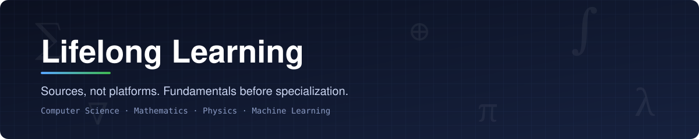
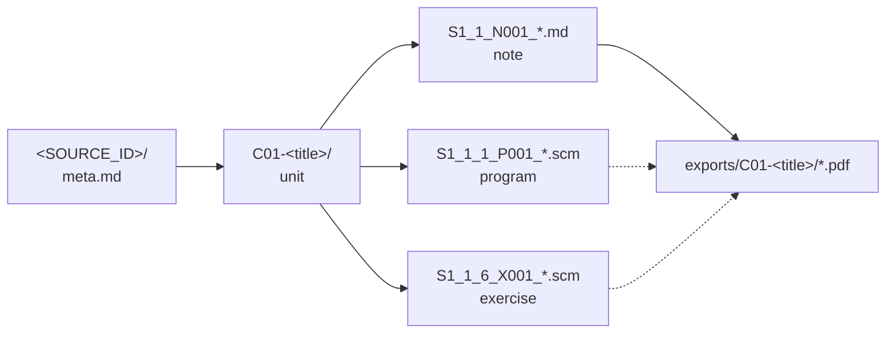

<p align="center">
  
</p>

# Lifelong Learning

A self-directed journey of learning built around sources: books, courses,
video series, articles, and papers. It follows the breadth and depth of
rigorous undergraduate and graduate-level programs from leading
universities, spanning Computer Science, Mathematics, Physics, Machine
Learning, and any other field worth studying seriously.

The learning is organized around sources rather than individual online
platforms. Each source represents a course or a substantial block of study
and has its own directory, identified by a unique abbreviation derived from
the source's title, optionally followed by its edition number. `ALG4`
identifies _Algorithms_, 4th edition; `DISMATH8` identifies _Discrete
Mathematics and Its Applications_, 8th edition; `CODETHL` identifies
_Code: The Hidden Language of Computer Hardware and Software_. The
abbreviation should be descriptive, recognizable, and distinct from every
other one.

This README is the source of truth. It documents invariants: patterns and
placement rules, not the current contents. If a rule changes, change it
here first.

## Dashboard

Consistency and growth, derived entirely from `git log` and from the
filenames. Nothing in this block is written by hand.

<!-- stats:start -->
<!-- stats:end -->

The block above is generated by [`tools/stats.py`](tools/stats.py) and
refreshed by a [GitHub Action](.github/workflows/stats.yml). See
[Dashboard rules](#dashboard-rules).

## Layout

```text
.
├── templates/         root templates: meta-template.md, notes-en.tex, notes-pt-br.tex
├── materials/         staged source files and the track catalog
├── attachments/       images and other files referenced by notes
│   └── stats/         generated dashboard images, never edited by hand
├── tools/             scripts that serve the repo itself (stats.py)
├── .github/           automation (dashboard workflow)
├── .build/            compilation byproducts, never versioned
├── <SOURCE_ID>/       one directory per source
│   ├── meta.md        bookplate, written once, never updated
│   ├── .exports-root  enables this source's exports/
│   ├── materials/     the source's own files
│   ├── templates/     pre-filled templates, only when the source needs them
│   ├── exports/       generated PDFs, mirroring the unit paths
│   ├── C01-<title>/   first unit: chapter, lecture, episode or part
│   ├── C02-<title>/   ...
│   └── ...
└── README.md
```

No folders by area, language or date. Directories beginning with `_` are
private and excluded from version control.

The life of a note, from source to archive:



## Units and Files

Material inside a source is organized by unit, one directory per chapter,
lecture, episode or part, numbered in source order:

```text
C01-<unit-title>/
```

A unit directory contains only flat study files — never subfolders.
There are no `notes/` and `exercises/` directories: the type prefix in
each filename already tells what a file is, and flat files keep every
artifact of a unit side by side. An atomic source (an article or paper)
has no unit directories; its files sit directly in the source root. A problem
set is also flat: each problem is a single file in the source root, numbered
in the order it was solved, because the platform imposes no chapter order.

Files follow one universal pattern:

```text
S<m>[_<n>[_<p>]]_<T><NNN>_<slug>.<ext>
```

- `S<m>[_<n>[_<p>]]` — the section of the source, with underscore-separated
  levels (`S1.1.2` is written `S1_1_2`). `S00` is general material not tied
  to a specific section.
- `<T><NNN>` — content type and a zero-padded sequential number, restarting
  within each section: `N` note, `P` program or code example annotated with
  explanatory comments, `X` exercise. Code files are notes in their own
  right and live in the same unit as conceptual notes. Alphabetical order —
  N, P, S, X — is the pedagogical reading order.
- `<slug>` — snake_case, lowercase, ASCII.

The pattern uses only `[A-Za-z0-9_]` plus the extension dot, so every
filename is a valid identifier in every mainstream language. A language
may require one deviation (Java: the slug is camelCase so it matches the
public class name); no other deviations exist. Notes and code are written
in English or Portuguese, and the slug keeps the language they were
written in.

Examples:

```text
S1_1_N001_the_elements_of_programming.md
S1_1_1_P001_expressions.scm
S1_1_6_X001_evaluation.scm
S00_N001_chapter_summary.md
S1_1_X016_exR1.java
```

## Headers

Every Markdown note carries a frontmatter header; every code file carries
the comment block the header snippet generates. Only the Markdown header
is specified here; code headers keep their generated structure untouched.

```yaml
---
title: <note title>
tags:
    -
description:
authors:
source:
location:
aliases:
    -
lang: <lang-code> # en-US or pt-BR
date: <ISO date>
id: <id>
---
```

- `title` — the note title (matches the filename stem).
- `tags` — empty list by default; add `- <tag>` as needed.
- `description` — short description of the note content.
- `authors` — note authors (if different from source authors).
- `source` — source book/course identifier.
- `location` — where in the source the note belongs (chapter, pages).
- `aliases` — empty list by default; add `- <alias>` as needed.
- `lang` — language code of the note content (`en-US` or `pt-BR`).
- `date` — ISO datetime when the note was created (or the date you’re recording).
- `id` — note identifier (UUID or descriptive string); leave empty `id: ` if unknown.

The fields `file_name`, `created_at` and `modified_at` are **removed** from this format.
Use `date` for creation and keep the note body’s edit history if needed.

When a file is renamed or moved, the `title` and `source`/`location` fields
should be updated to match the new filename and path.

The PDF export injects the real filename as `file_name` metadata into the
exported document's reference block, so a stale header makes the exported
document lie about its own name.

## meta.md

A bookplate. Written once, when the source is created, and never updated
again: bibliographic reference (ABNT), source type, subject and scope,
learning objectives, links. Anything that changes over time — progress
above all — belongs in the structure, not in this file. The highest unit
directory with content is the progress. Book-specific conventions, such
as the programming language used in exercises, live in the source's own
`meta.md`.

## Templates

The root `templates/` directory holds the base templates: the
`meta-template.md` bookplate template and a LaTeX template per language
(`notes-en.tex`, `notes-pt-br.tex`). A source with conventions of its own
keeps pre-filled copies under its own `templates/`; until a language
template reaches the root, it lives only in the source that uses it.
Template names are the same everywhere.

Notes exist in two forms on purpose: the working Markdown/code notes and
the typeset PDF. Long-term permanence matters, and having a lightweight
working format alongside a polished archival format is a goal in itself.

## Exports

Every generated PDF lives in the `exports/` folder of its own source,
mirroring the path of the note relative to the source root:
`ALG4/C01-fundamentals/S1_1_N001_basic_programming_model.md` becomes
`ALG4/exports/C01-fundamentals/S1_1_N001_basic_programming_model.pdf`.
Compilation byproducts go to the hidden root `.build/` directory and are
never versioned.

The `exports/` location is decided by the Neovim exports module, which
resolves the note's root by markers in priority order:
`.exports-root` first, then version control roots, then README/LICENSE
markers, falling back to the note's own folder. Each source directory
carries `.exports-root`, which is what pins its exports to itself.

## Materials

`materials/` is the vocabulary across the workspace: the files that come
from the source itself. A source's own PDFs, data files and downloads live
in its `materials/`; books not being studied yet are staged in the root
`materials/`, which also holds the track catalog
(`catalogo-cursos-cs-es.pdf`). Images referenced by notes go to the root
`attachments/`.

## Dashboard rules

The dashboard follows the same principle as the rest of the repo:
conventions over classification. Because the filename pattern already
encodes source, unit and type, no extra bookkeeping is needed.

- **Derived, never declared.** Every number comes from `git log` or from
  filenames matching the pattern in [Units and Files](#units-and-files).
  A file that does not match the pattern is not counted.
- **Generated, never edited.** Everything between `<!-- stats:start -->` and
  `<!-- stats:end -->`, and everything in `attachments/stats/`, is
  overwritten on every run. Change `tools/stats.py` instead.
- **What counts.** A source is a top-level directory with a `meta.md`.
  Units are `C<NN>-*` directories with at least one matching file. Notes,
  programs and exercises are counted by the `N`, `P` and `X` prefix, and
  each file is dated by the commit that first added it, following renames.
- **Commits.** The heatmap counts commits by author date. Commits whose
  author name contains `[bot]` are excluded, so the dashboard's own
  updates never inflate the consistency it measures.
- **Streaks.** A day is active if it has at least one commit. The current
  streak survives until the end of the day: if today has no commit yet, it
  counts back from yesterday.
- **Theming.** Every chart exists in a light and a dark variant and is
  embedded with `<picture>`, so it follows the viewer's theme.
- **Running it.** `python tools/stats.py` from anywhere inside the repo
  (standard library only, requires `git` and full history).

## Philosophy

- Fundamentals before specialization.
- Understanding before memorization.
- Mathematical rigor where appropriate.
- Programming and computation as means of understanding concepts, in any area.
- Theory and practice should reinforce each other.
- Areas of knowledge should reinforce each other, and connections across
  them are worth making explicit.
- Exercises are part of the learning process, not optional supplements.
- Sources are treated as primary structured knowledge; external resources
  are used when they improve understanding, not merely to increase the
  amount of material.
- Depth is preferred over superficial coverage.
- Conventions over classification: organization comes from predictable
  patterns, not from manual processes.

The purpose is not simply to collect completed sources. The purpose is to
develop a coherent understanding of the fundamental areas studied here
and the ability to apply that knowledge independently.

## Private Material

Directories beginning with `_` are private and intentionally excluded
from version control. They allow personal or unpublished material to
coexist with the public portion of the repository.

## Useful Links

### Open Libraries

- Project Gutenberg (public-domain literature): https://www.gutenberg.org/
- Standard Ebooks (well-formatted public-domain literature): https://standardebooks.org
- Internet Archive (digital lending of technical books): https://archive.org
- Open Library: https://openlibrary.org
- Free Programming Books: https://github.com/EbookFoundation/free-programming-books
- LibreTexts (open textbooks across sciences and mathematics): https://libretexts.org

### Roadmaps and Courses

- Teach Yourself CS: https://teachyourselfcs.com
- MIT OpenCourseWare: https://ocw.mit.edu
- CS50 (Harvard): https://cs50.harvard.edu/x
- Nand2Tetris: https://www.nand2tetris.org
- Papers We Love: https://paperswelove.org
- fast.ai (practical deep learning): https://www.fast.ai

### Books and Companion Sites

#### Computer Science

- Algorithms (Sedgewick & Wayne), companion site: https://algs4.cs.princeton.edu
- Open Data Structures: https://opendatastructures.org
- Operating Systems: Three Easy Pieces (OSTEP): https://pages.cs.wisc.edu/~remzi/OSTEP/
- Computer Systems: A Programmer's Perspective (CS:APP): https://csapp.cs.cmu.edu
- Structure and Interpretation of Computer Programs (SICP): https://mitpress.mit.edu/sites/default/files/sicp/index.html
- Crafting Interpreters: https://craftinginterpreters.com

#### Mathematics

- Mathematics for Computer Science (MIT 6.042J): https://ocw.mit.edu/courses/6-042j-mathematics-for-computer-science-spring-2015/
- OpenStax: https://openstax.org
- Open Textbook Library: https://open.umn.edu/opentextbooks
- Khan Academy: https://www.khanacademy.org
- 3Blue1Brown (visual intuition for linear algebra, calculus): https://www.3blue1brown.com

#### Physics

- The Feynman Lectures on Physics (online edition): https://www.feynmanlectures.caltech.edu
- HyperPhysics: http://hyperphysics.phy-astr.gsu.edu

#### Machine Learning

- Mathematics for Machine Learning: https://mml-book.com
- An Introduction to Statistical Learning (ISL): https://www.statlearning.com
- Dive into Deep Learning: https://d2l.ai

### Documentation and Standards

- Arch Linux man pages: https://man.archlinux.org
- Arch Wiki (excellent for Linux internals, beyond Arch itself): https://wiki.archlinux.org
- POSIX specification (The Open Group Base Specifications): https://pubs.opengroup.org/onlinepubs/9699919799/
- Linux man-pages project: https://man7.org/linux/man-pages/
- Linux kernel documentation: https://docs.kernel.org
- GNU C Library (glibc) manual: https://www.gnu.org/software/libc/manual/
- GNU Make manual: https://www.gnu.org/software/make/manual/
- GCC documentation: https://gcc.gnu.org/onlinedocs/
- GDB documentation: https://sourceware.org/gdb/documentation/
- C standard drafts (WG14, open working papers): https://www.open-std.org/jtc1/sc22/wg14/
- Bash reference manual: https://www.gnu.org/software/bash/manual/
- Filesystem Hierarchy Standard: https://refspecs.linuxfoundation.org/fhs.shtml
- RFC Editor (internet standards, TCP/IP, HTTP, etc.): https://www.rfc-editor.org
- MDN Web Docs: https://developer.mozilla.org
- Intel and AMD architecture manuals (x86 reference): https://www.intel.com/content/www/us/en/developer/articles/technical/intel-sdm.html
